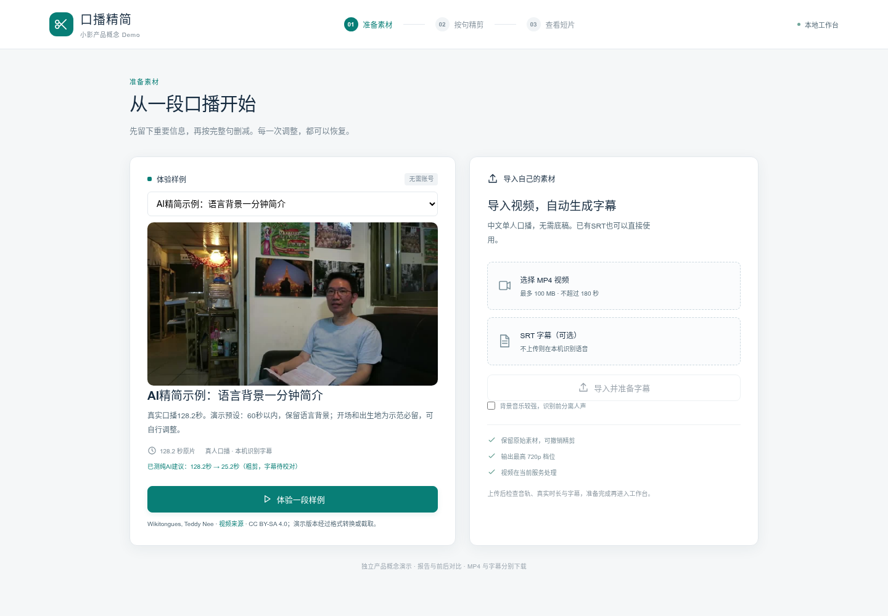
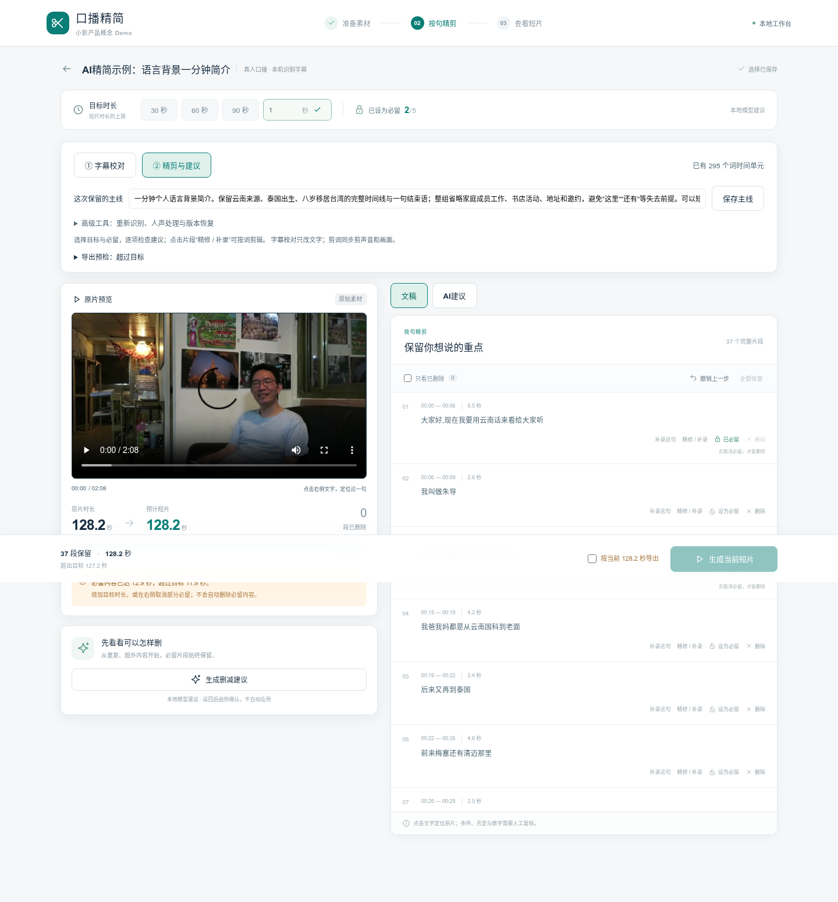
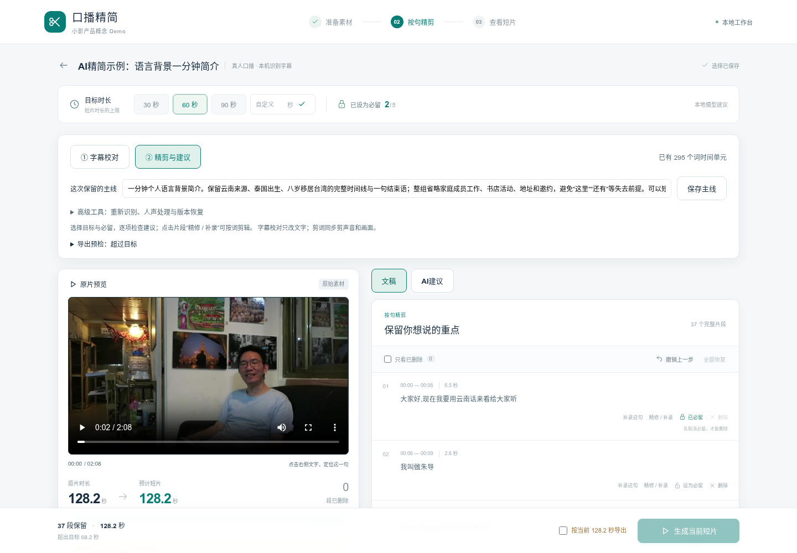
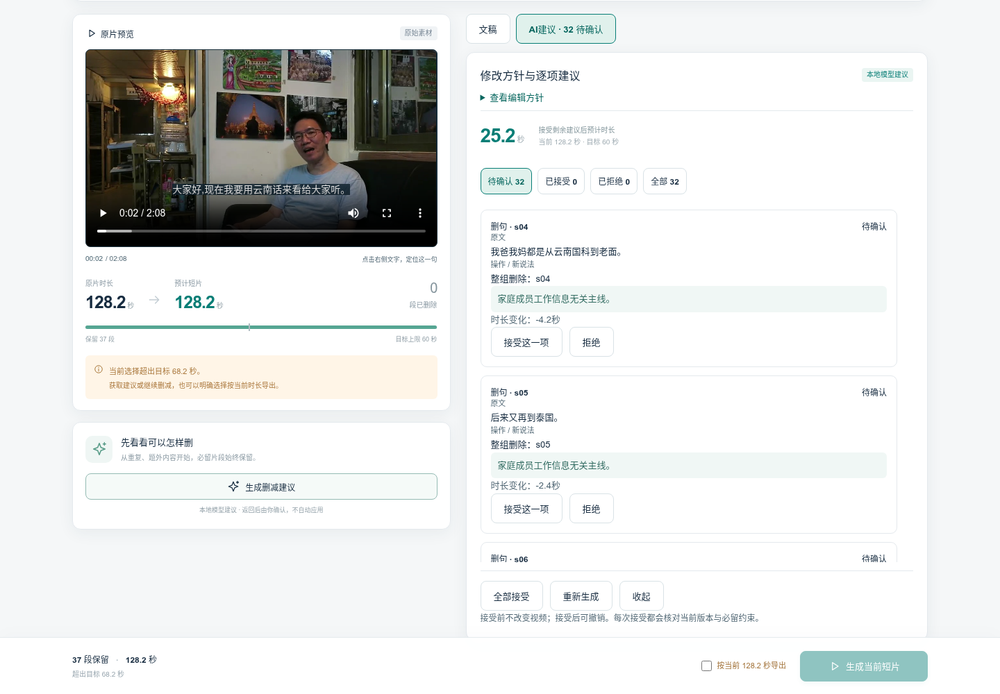
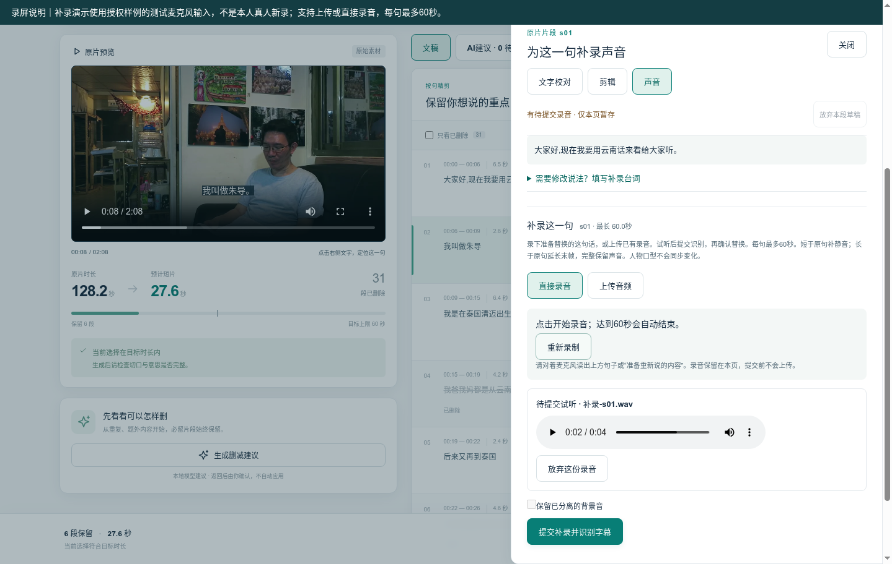
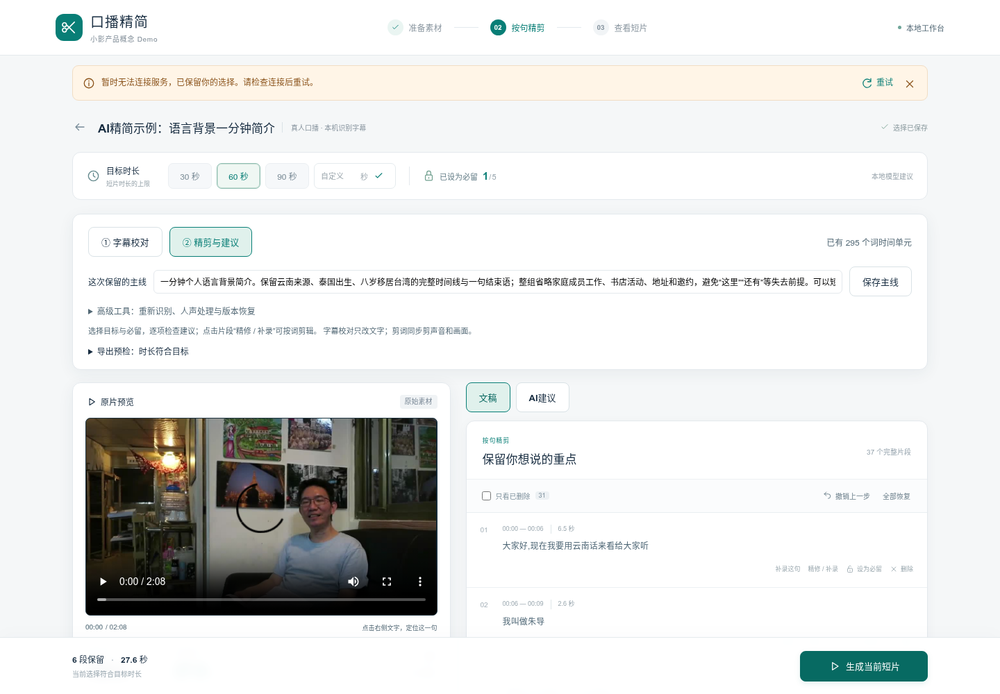
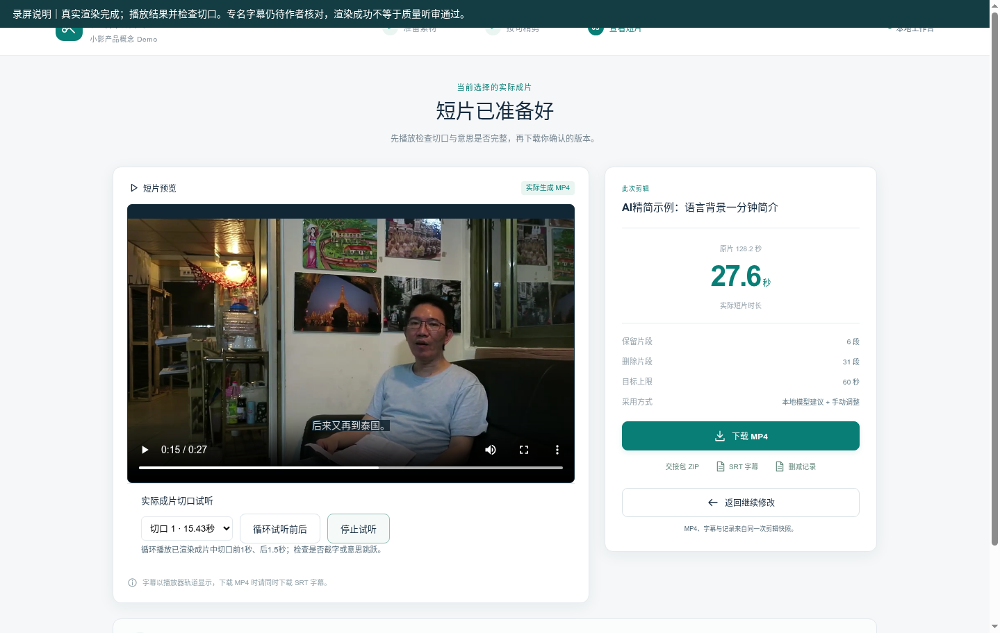
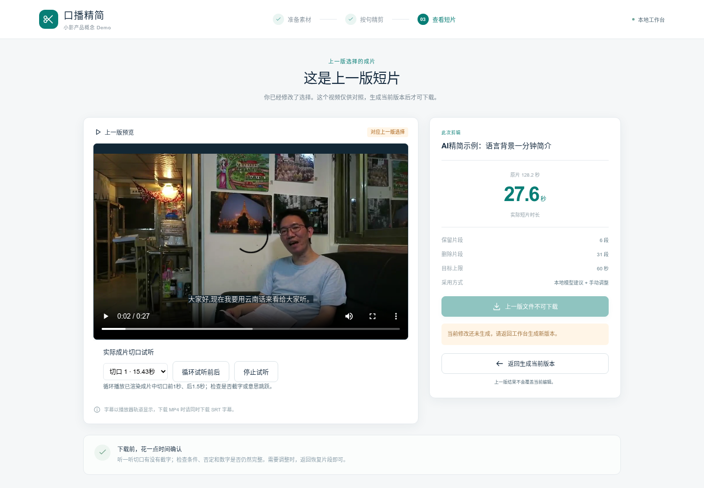

# 同版本八图流程
应用核心固定于fce60bf；全部为该版本真实页面。第2、6、8张在录屏后重新复现，确保错误反馈和视频预览清晰可读，不声称全部为视频截帧。

## 1 进入任务
选择已获授权的真人样例；目标是将已有口播整理成一分钟内简介。

## 2 保护必留内容
目标短于必留内容时提示冲突并禁用生成，不自动删除保护内容。

## 3 文稿与原片联动
核对主线、目标和句子，点击文字定位；可剪词、恢复和整句调整。

## 4 审核真实模型候选
本次Qwen实际推理148.2秒产生32项候选；作者可逐项接受、拒绝或批量确认。

## 5 为一句补录声音
上传或直接录音，先试听再识别和确认；图中使用授权样例测试输入，每句上限60秒。

## 6 失败后可继续
浏览器中断一次渲染请求，界面保留编辑并提供重试；服务端故障注入关闭。

## 7 播放和下载结果
本轮确认及手动恢复后导出27.588秒短片；切口可循环试听，MP4/SRT/记录同版下载。

## 8 继续编辑与版本保护
编辑后旧成片标注为上一版，保留预览并禁用当前下载，提示重新生成。

