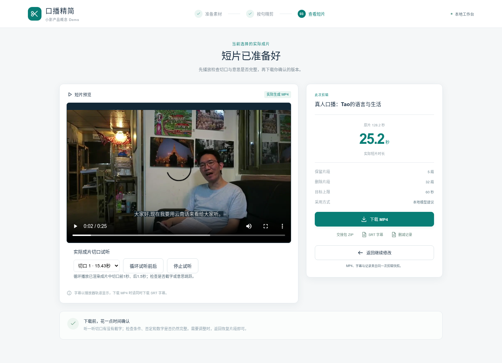
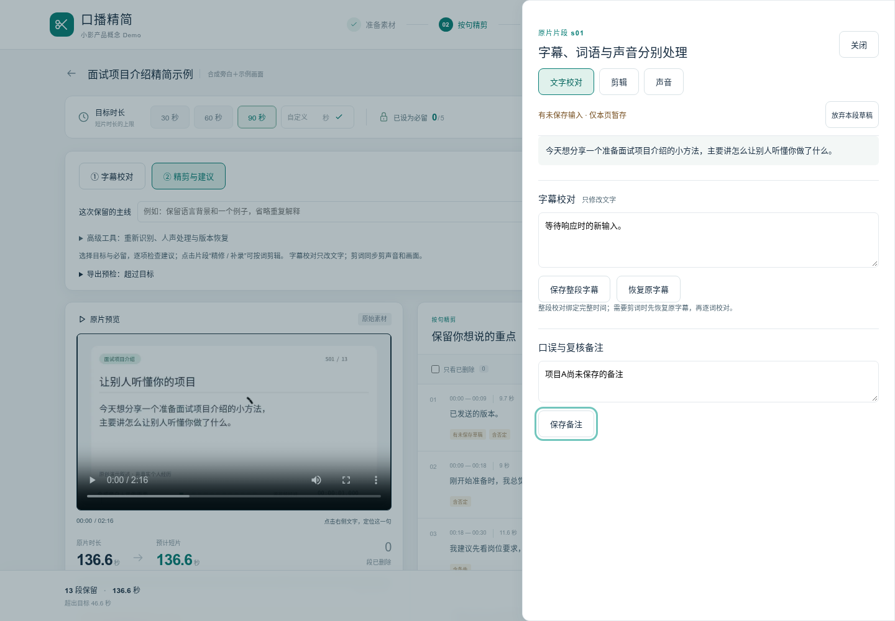

# 2026-11-06 独立审阅优化响应

依据0166eb6提交中的独立审阅，在70e3b6e实现上增量修复。保留原媒体与现有编辑流程；没有重开发编辑器或引入声线生成。

| 审阅项 | 本轮处理 | 证据/范围 |
|---|---|---|
| 草稿失败丢失、保存别字段丢失、跨项目污染 | 按项目/片段/字段隔离，仅清理保存成功且仍相同的字段；失败与迟到响应保留输入；页内最近项目返回、离开提示 | drafts单测、真实浏览器失败/迟到/跨项目用例；未承诺刷新后草稿持久化 |
| 补录请求串任务及孤立文件 | 先校验、再写盘；内容SHA和完整意图相同才复用，不同请求409；确认卡显示实际片段与文件；失败清理 | 相同/不同片段、文件、参数回归；实际手机上传与确认 |
| public仍可上传补录 | 服务层403且不写文件，前端禁用入口 | public_upload_validation.json；鉴权/配额等公网服务门槛仍未完成 |
| 测试覆盖与表述 | 新增V2语法检查、草稿与依赖组回归、多建议确定性fixture，真实推理另记；手机走完校对、剪词恢复、补录、试听、渲染下载 | 63项后端、14项前端；browser_validation.json；手机为模拟，软键盘为视口缩小 |
| 时长配置无效 | MAX_SOURCE_SECONDS传入媒体验证 | 实际6秒工程视频在1秒限额被拒绝 |
| 重新识别不可恢复 | 确认显示重置影响；高级工具提供版本恢复，revision递增 | 恢复备注、剪词与词时间戳回归；原状态备份 |
| 模型复现 | 下载默认固定revision/SHA，更新须显式--update；llama.cpp固定commit | runtime_manifest、README_V2、下载器校验 |
| 工具层级与状态可读性 | 高级工具折叠、精修三组、固定关闭/草稿状态、可读状态色、导出预检 | drafts-and-tabs.png；保留统一视觉体系 |
| 重绘中断试听/焦点 | DOM局部更新保留媒体节点、抽屉滚动、选区和焦点；Esc与Tab约束 | 浏览器验证播放节点相同、时钟继续、无pause/emptied事件；服务器用虚拟音频输出，不等于人工听审 |
| 切口质量 | 结果页按实际渲染帧区间循环试听切口前后 | mobile-complete.png及真实播放断言；自然度仍需人工 |
| 无意义极短样片 | 新任务导向示例128.2→25.188秒，保留5段个人背景主线，原声不改写；模型判断相关性及依赖，作者确认后应用 | SHOWCASE.md、完整评分/候选、真实MP4、showcase-result.png；专名字幕待校对 |
| 文档与交付 | 当前README、范围表、质量协议、固定白名单HTTP交付中心和哈希索引 | `/delivery`经SSH可直接观看/下载；大媒体仍未托管GitHub |

## 真实模型与工程用例分开

展示片由本机Qwen推理约199.9秒，产生32项删除候选，全部接受后实际FFmpeg渲染25.188秒；没有以预制ID列表冒充推理。编辑任务和两段必留是显式预设。人工先后检查过过短但衔接不完整的候选，调整了公开的编辑目标与依赖判断；最终运行及全部评分留档。单个选定示例不证明普遍质量。

多项接受/拒绝/全部接受测试使用明确的确定性候选fixture和真实决定接口，确保每条路径实际执行；这部分不算真实模型质量证据。移动端15.3秒文件仅为工程工作流测试，不作成果封面。

本轮补充56.16秒连续真实录屏，1404帧，包含原片/成片播放、实际切口试听和下载，带浏览器声音（均值-23.9dB），不含推理等待过程。

## 仍保留的后续项

- 新录真人补录、作者听审、已校对最终字幕、普通话/口音/数字/否定语义真值评估。
- 真实手机软键盘与实机媒体体验、5–8名目标作者的任务对照研究。
- 校对后强制对齐、输出烧录样式、安全区、原生宿主集成与公共服务加固。双皮肤和声线生成不在本轮。

本轮完成的是可靠性修复、验收覆盖和可访问的真实粗剪展示，不将原始需求全部完成或商业价值已验证作为结论。
