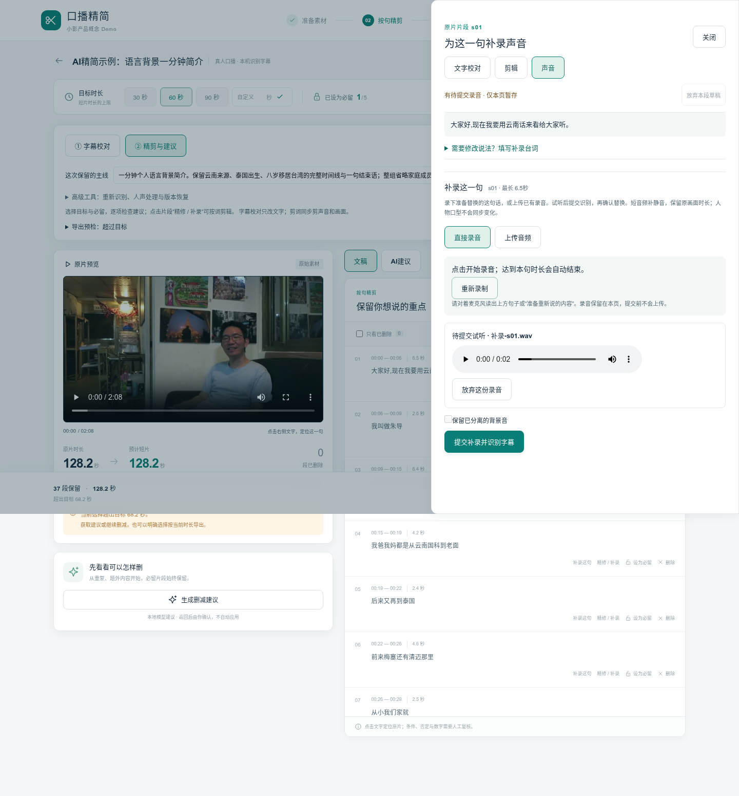
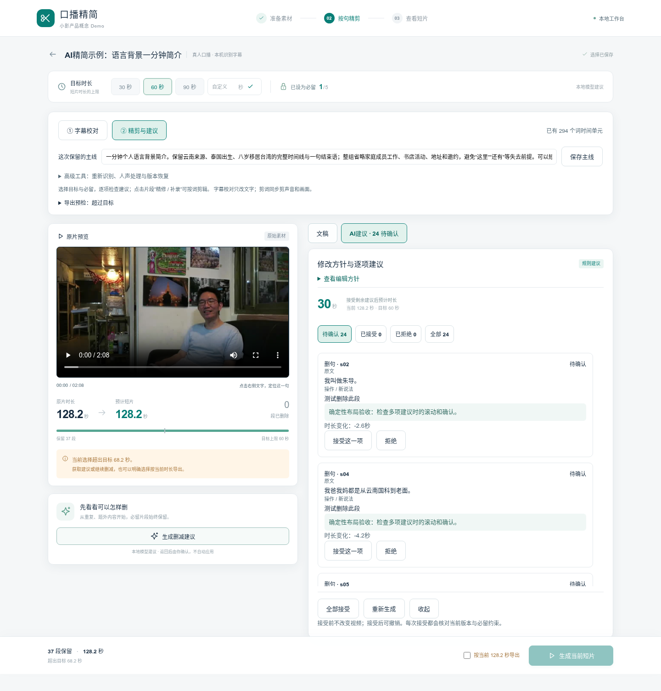

# 句子直接录音与建议布局（2026-11-07）

> 本文记录b83784d布局基线；补录时长现已放宽至60秒，见[后续更新](../minute_recording/RELEASE.md)。

在9a1e646版上增量完善，复用补录上传、识别、确认、真实渲染和版本保护。用户反馈：补录需同时支持上传/直接录音，多条建议不能只堆在左栏。

## 操作变化

1. 文稿每句新增“补录这句”，直接打开该句声音面板。已必留句需先取消必留。
2. 可选“直接录音”或“上传音频”。录音需要浏览器麦克风授权，支持开始、结束、取消、试听、重录及放弃；到该句时长自动结束。选择另一句不会带入上一句录音，关闭面板再打开同一句可继续提交。
3. 点击“提交补录并识别字幕”，检查片段、文件和识别结果后再确认替换。录音在明确提交前只保存在本页；刷新/离开有未提交提示。
4. 右侧为“文稿 / AI建议”切换，生成后自动打开建议。建议内部滚动，按待确认/已接受/已拒绝/全部筛选；批量确认始终在列表外，左侧保持原片预览。
5. “修改说法”折叠为可选台词输入，录音控件和试听更靠前。

## 运行方式与边界

继续使用8767；通过SSH转发后在自己的浏览器打开 `http://localhost:8767`，刷新页面加载新版。HTTP远程IP通常不提供麦克风能力，须用localhost或HTTPS。浏览器能力依据 [MDN getUserMedia](https://developer.mozilla.org/en-US/docs/Web/API/MediaDevices/getUserMedia) 与 [MediaRecorder](https://developer.mozilla.org/en-US/docs/Web/API/MediaRecorder)。没有麦克风权限/设备时给出提示，上传入口保持可用。

浏览器按支持的编码录制，再在本机转换成有明确时长的16位单声道WAV，复用原上传接口，不把WebM缺失duration的问题交给用户。录音最长为所选句子的画面时长，停止/取消后释放麦克风，迟到的授权不能启动已取消的录音。不改变原画面时长，不生成同声线或口型同步。

## 验证口径

- 16项前端检查（含WAV采样/时长边界、取消后迟到麦克风释放）。
- 10组新增浏览器验收：真实MediaRecorder、WAV、HTTP、ASR、确认替换、实际MP4导出；权限拒绝、自动停止、取消、跨句隔离、上传试听与手机尺寸控制。
- 浏览器麦克风使用授权原片的测试输入设备，不冒充真人新录音或实机麦克风测试。24条候选是明确的布局交互fixture，接受/拒绝通过真实接口；模型算法未改。
- 之前草稿、迟到响应、跨项目、多项建议及手机补录/渲染回归另记regression_validation.json。
- 本轮主要是前端变更，后台补录协议与媒体管线保持原实现；不把历史63项后端测试说成本轮重新运行。

手机截图为浏览器尺寸模拟，见mobile-suggestions.png。浏览器及具体布局尺寸记录见browser_validation.json。
