# 口播精简 V2：产品目标、竞品研究与实际演示

本报告附真实Demo截图与公开竞品资料。完整PDF/HTML、录屏及源码包见本地交付目录。

本项目帮助中文教程、知识分享和经验分享作者，把已经录好的口播整理成可发布的短片。V2把字幕准备、文字精修、按词删减、整句重排、人工补录和建议确认串成一个可检查、可撤销的流程。

## 1. 用户、任务与市场定位

核心用户是独立内容创作者：有一段约90–180秒的中文口播，想压缩到60或90秒，同时保住条件、数字和关键论点。作者知道自己想表达什么，但反复定位、剪切、检查字幕与重新补录会打断工作。

这是来自任务书的产品假设，尚未通过用户访谈验证。首轮验证重点是任务能否完成、结果是否与编辑一致，而非宣传节省百分之多少时间。

典型任务包括：发布教程前删除重复解释；把面试项目介绍整理成短版；校正自动字幕中的专名；发现口误后记录更正并替换录音；在背景音乐较强时先提取人声识别。

产品定位仍是VivaVideo口播编辑流程的专项概念演示。差异集中在“目标时长—必留—可解释建议—恢复—真实导出”的组织方式。文本剪辑已是成熟能力，本项目的价值需要用确认成本、切口质量和端到端完成率证明。

商业上适合作为现有编辑产品中的创作工具或会员能力。观察指标应包括：从导入到合格导出的总耗时、字幕纠错次数、建议接受/拒绝率、恢复操作、失败重试和再次使用意愿。目前没有真实商业转化或营收数据。

## 2. 旧版界面与主要缺口

旧版已支持MP4+SRT导入、自定义目标、必留、整句删除/恢复、规则建议、实际MP4预览及同源字幕下载。旧版真实界面和录屏已归档，原136.567秒合成样例哈希保留。

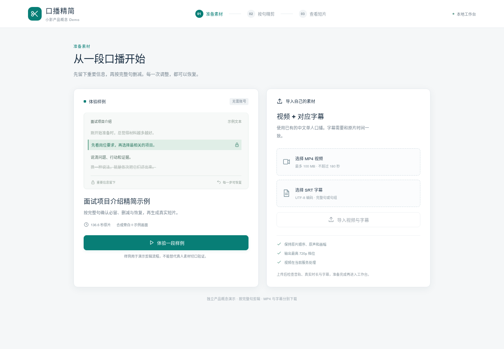

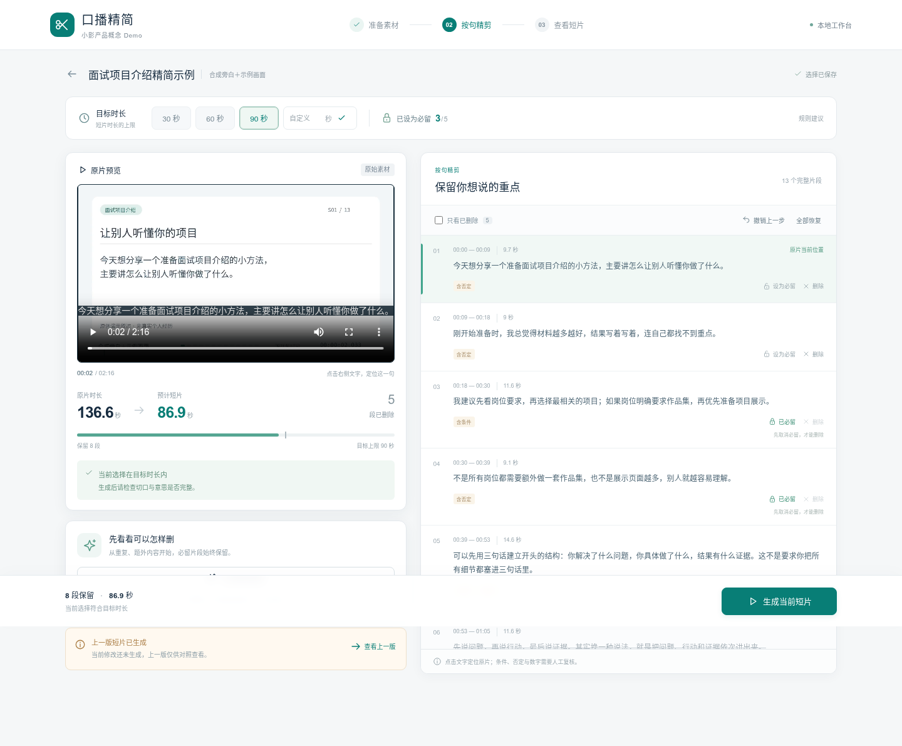

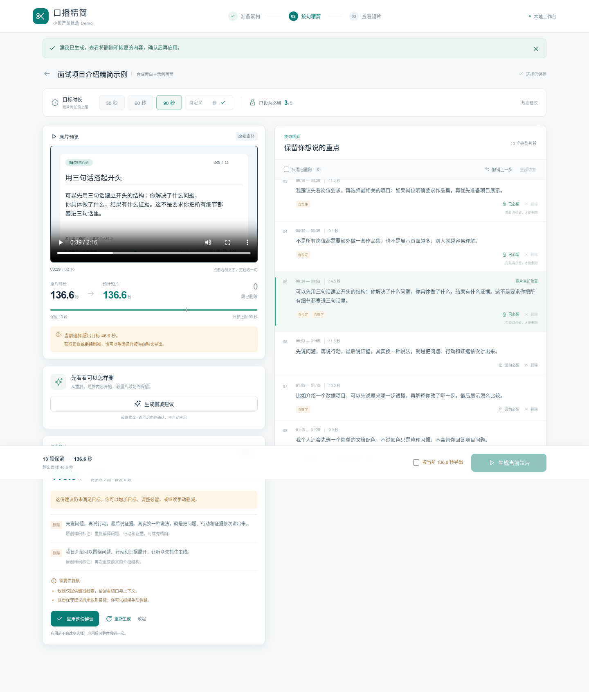

人工验收意见暴露出六类缺口：字幕准备依赖外部SRT；不能校对词语或备注口误；修改文字与改变声音未形成完整流程；建议缺少整体策略和逐项采纳；背景音处理缺失；合成示例和前后流程衔接不足。V2按这些缺口推进，而不是重新搭建整个产品。

## 3. 竞品调研与可借鉴设计

本节依据公开官方资料及其真实页面/界面示例。截图标注为官方帮助示例或公开产品页，未冒充登录后的付费产品实测。功能是否在特定地区、平台和账号版本开放，需要单独核对。

| 产品 | 官方资料展示的能力 | 本次学习点 | 与本Demo的主要差距 |
|---|---|---|---|
| VivaVideo | 自动字幕、AI配音、多轨编辑等编辑能力 | 把口播精简嵌入素材准备与完整创作流程 | 本Demo仍是独立网页，未连接真实移动端工程和发布系统 |
| 剪映／CapCut | 自动转写、文本关联媒体删减、删除内容展示及语气词处理 | 直接从视频进入文本编辑；编辑后立即看懂删了什么 | CapCut已将文本剪辑与更完整的素材、字幕和时间线工具结合；本次不将海外CapCut资料直接等同所有剪映版本 |
| Descript | 文稿与媒体联动删除、移动；字幕纠错、时间对齐与行内备注 | 区分文字校对和媒体编辑，保留恢复与备注能力 | 成熟产品对词时间轴、协作及语音编辑的组织更完整 |
| Premiere | 自动转写，选取/重排文本生成时间线，再做精确调整 | 文本先完成粗剪，专业时间线接手精修；最终序列再生成字幕 | 本Demo无专业多轨时间线、三点编辑及原生工程互通 |

### VivaVideo：承接现有创作流程

官方产品页介绍自动字幕、AI配音和多轨编辑等能力。我们把入口定位在“素材导入之后、包装发布之前”，提供真实交接包；未来原生集成应复用宿主的素材库、字幕轨和工程管理，而不是再维护一套孤立项目。[官方产品资料](https://quvideo.com/zh-Hant/products)

### CapCut：文字编辑和实际媒体关联

CapCut官方教程展示导入后生成文稿，通过删文字删除相应视频，以及显示或隐藏已删文字。学习重点是让编辑和恢复结果清楚可见。[官方教程](https://www.capcut.com/resource/edit-video-with-text)

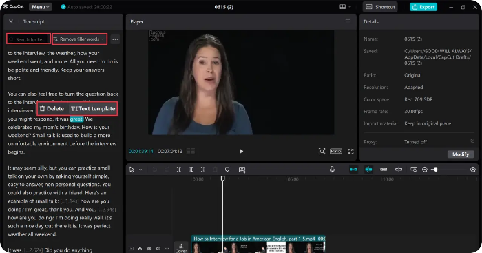

### Descript：校对、剪辑与备注分开

Descript的官方说明把删除媒体、移动句子、校对转写和行内备注分别解释。这个区分直接影响用户理解：修改一个错别字可以只改字幕，而改写实际说法必须有对应声音。其AI语音路线属于不同能力层，本轮采用人工补录。[编辑说明](https://help.descript.com/getting-started/edit-like-a-doc)、[语音功能入口](https://help.descript.com/script-editing/speakers)

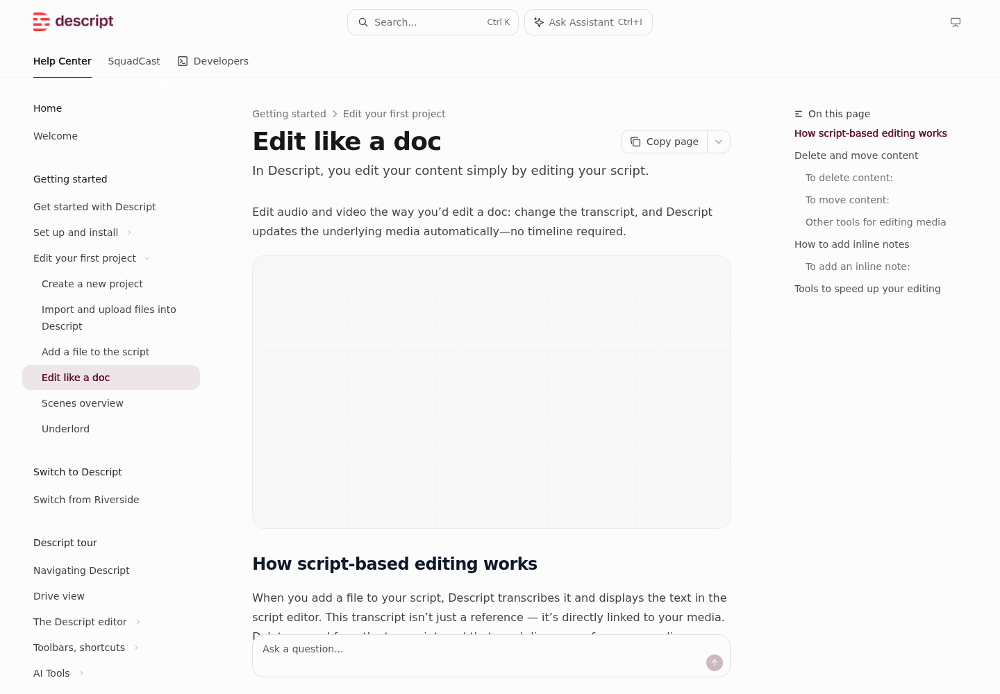

### Premiere：文本粗剪与时间线精修衔接

官方文档展示带时间码的文稿、节目监视器与多轨时间线，文本删改和重排会映射到媒体。文档同时提示字幕应依据最终编辑序列生成。我们因此以同一剪辑清单生成视频、VTT和SRT。[官方说明](https://helpx.adobe.com/premiere/desktop/edit-projects/edit-video-using-text-based-editing/overview-of-text-based-editing.html)

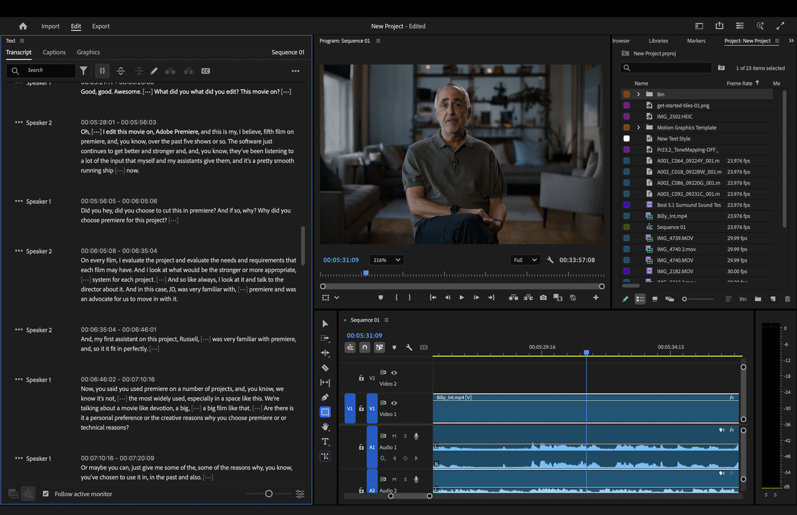

Adobe文档在本机Chrome直接访问返回403；上图来自该官方文章链接的Adobe图片资源，不使用403错误页面充当产品截图。详细抓取地址和证据类型见research/sources.json。

## 4. V2流程与操作实例

新流程为：素材准备 → 字幕校对 → 精剪与建议 → 真实预览与导出。视频可以没有字幕，也不需要PPT或底稿；已有SRT仍能使用。

### 4.1 真人样例与自动字幕

首页提供Tao与Ying的真人语言分享视频，来源为Wikitongues，经Wikimedia Commons提供，采用CC BY-SA 4.0。视频作者、来源、截取/格式变化和哈希写入manifest。视频为真实录制，字幕由本机模型生成；有口音及专名错误，保留待校对状态。

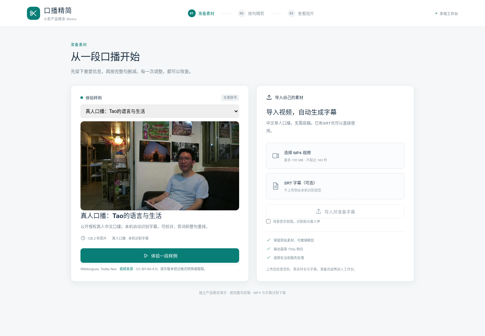

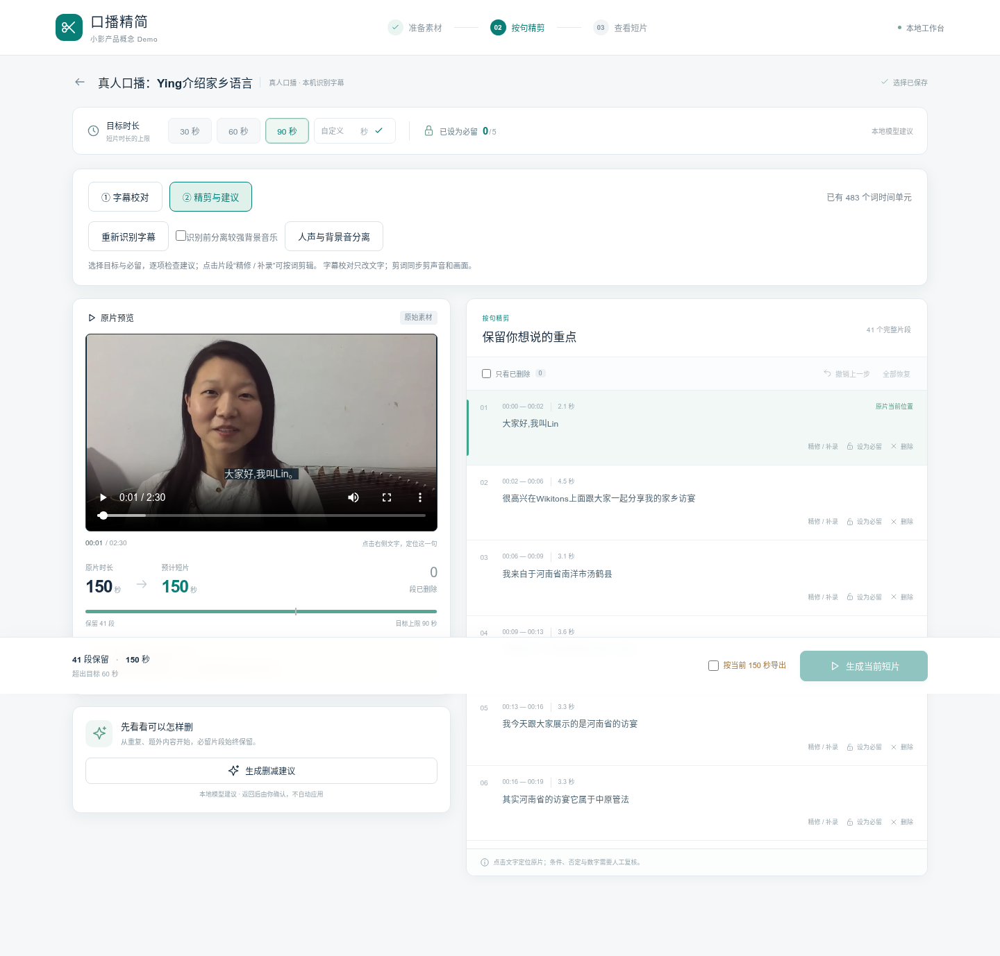

自动识别中，Ying素材出现“访宴”等应由作者核对的词语。这正是校对步骤的用途：识别结果是编辑起点，不能未经检查直接作为最终字幕。模型输出和处理耗时保存在speech_validation.json，未使用固定示例字幕冒充实时识别。

### 4.2 校对、备注与真实剪词

“精修 / 补录”面板提供整段字幕校对、逐词校对和口误备注。文字校对保持音视频区间；删除词语则同步删除实测区间中的声音和画面。词切点量化到30fps，短于一帧或对齐重叠的单位合并显示，不能按字符数量虚构时间。

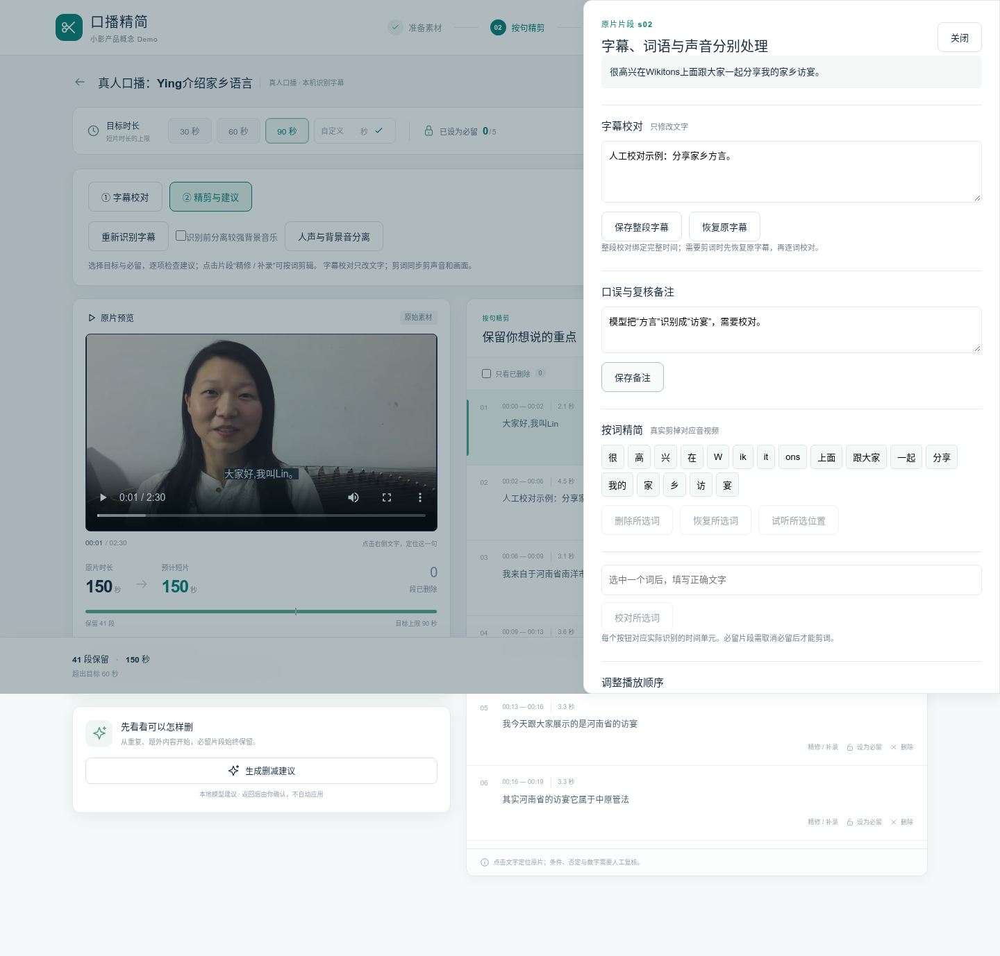

整段校对文字绑定完整区间；需要进一步剪词时，恢复原字幕后逐词校对。这个首版限制避免一段改写文字被错误映射到不存在的逐字语音。下一步可研究经过确认的强制对齐，提高校对后继续精剪的流畅性。

### 4.3 整句重排与人工补录

完整句组可以前移或后移，输出音视频及字幕按相同顺序重组。必留保护覆盖句内词语。撤销能够恢复前一次编辑，不会把旧成片当成新版本。

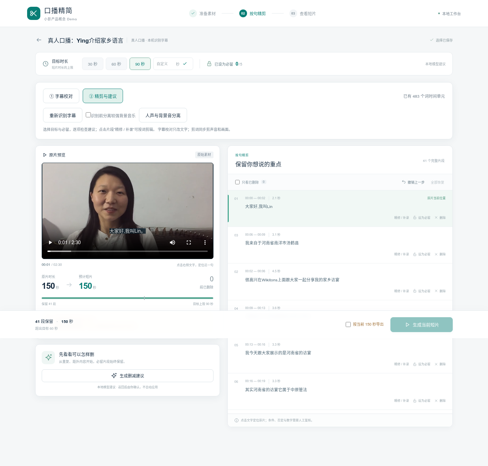

修改说法进入待补录状态。用户上传WAV、MP3或M4A，系统检查时长、识别补录字幕并提供试听，确认后替换。短音频补尾部静音，过长要求缩短；保持原段画面长度，不处理人物口型。带BGM时可在分离后保留背景音。

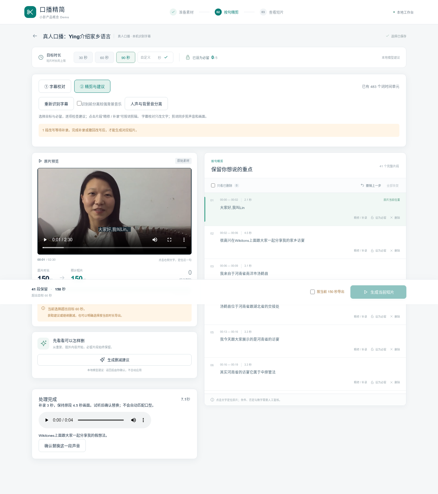

本轮补录接口验收使用了授权Ying原片中的3秒片段作为替换音频，验证真实上传、识别、混合与替换链路；它不是新录制的人声，也不是同声线合成。

### 4.4 整体修改方针与逐项采纳

本地Qwen模型根据当前文字、目标和必留状态生成方针与具体操作。界面展示原文、操作或新说法、理由和是否需要补录。用户可以逐项接受、拒绝或全部接受；接受一项后仍可处理不冲突的剩余项，手动编辑则使原建议过期。

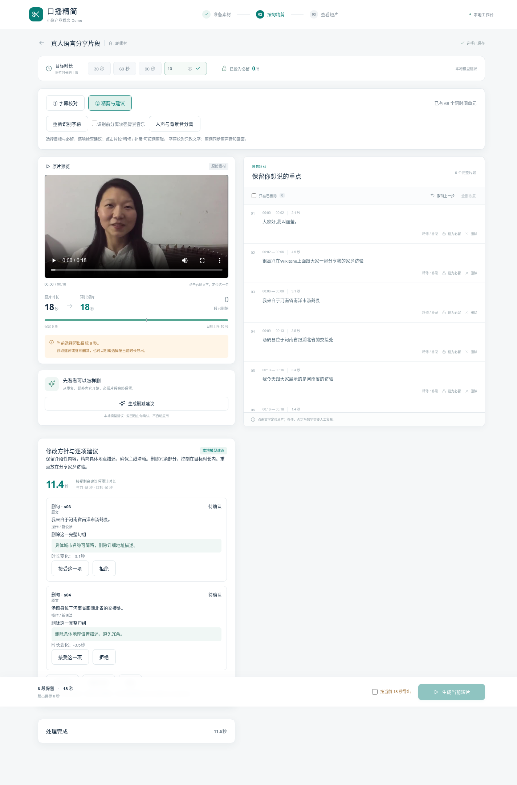

模型只能引用有效片段和词ID。必留由代码保护，时间由媒体区间计算，改写不会自动生成新声音。模型不可用时，界面明确显示规则回退及原因。

### 4.5 预览、下载与后续流程

确认完成后才生成正式MP4。视频、字幕和编辑记录来自同一快照，下载与预览为同一文件。交接ZIP包含MP4、SRT、VTT、JSON及适用的署名许可文本，便于交给其他编辑器或后续开发模块。

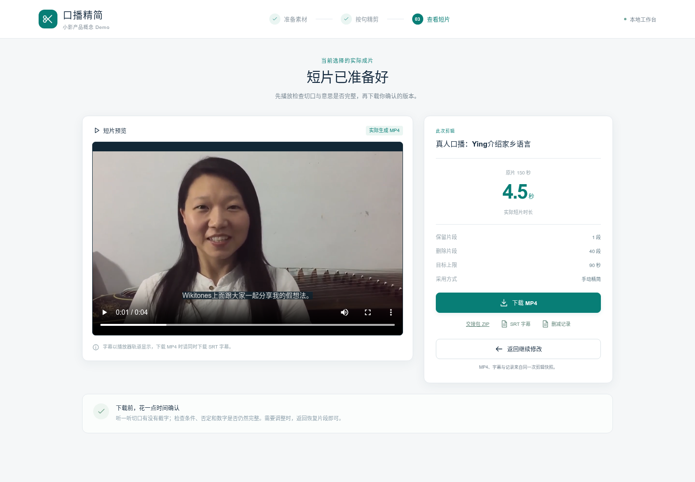

JSON是可追溯剪辑记录，不是Premiere或其他产品的原生工程文件。下一阶段可在宿主产品确定后接入其工程格式、素材标识与发布前检查，避免先制造没有实际目标的跳转按钮。

## 5. 背景音处理与工程验证

本机ASR采用faster-whisper medium、CPU int8和VAD；背景分离采用Demucs htdemucs。识别可选择原混合音频或分离人声，用户可以分别试听人声与背景轨。普通导出默认沿用原音频，避免未经确认把分离伪影带入成片。

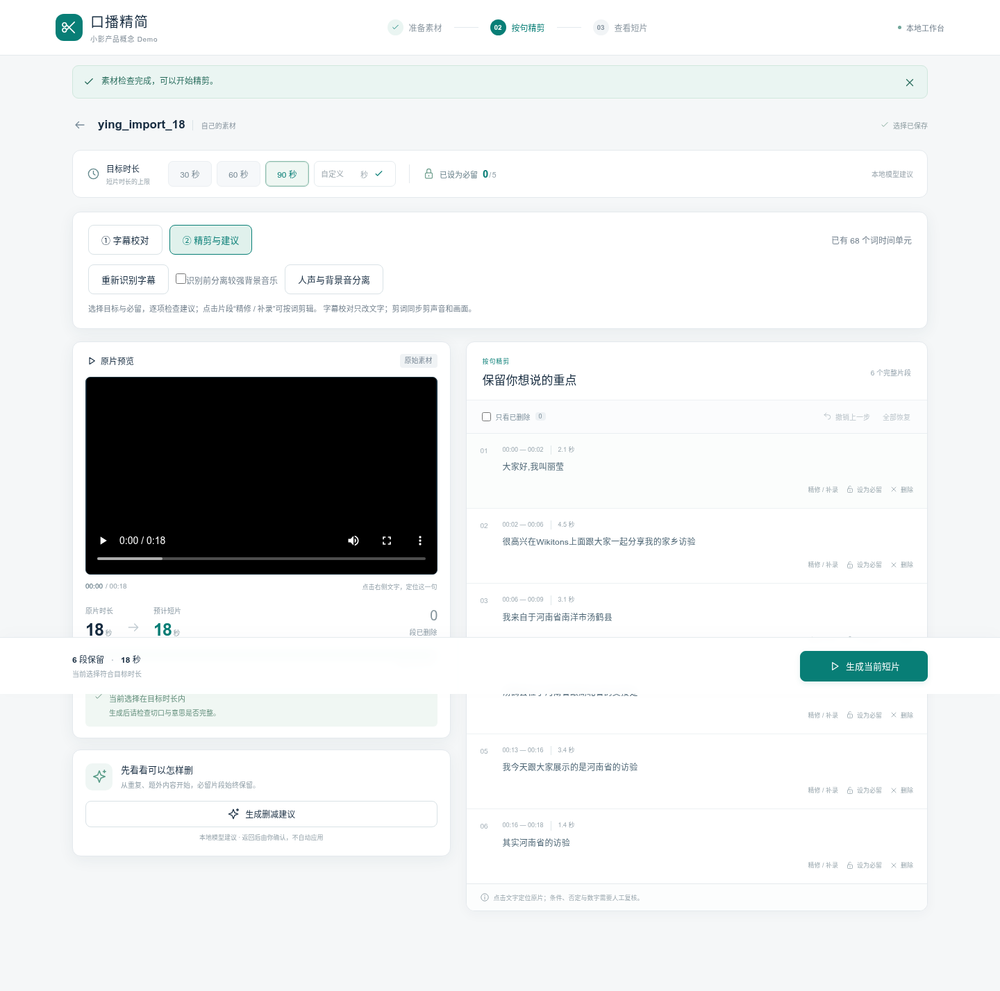

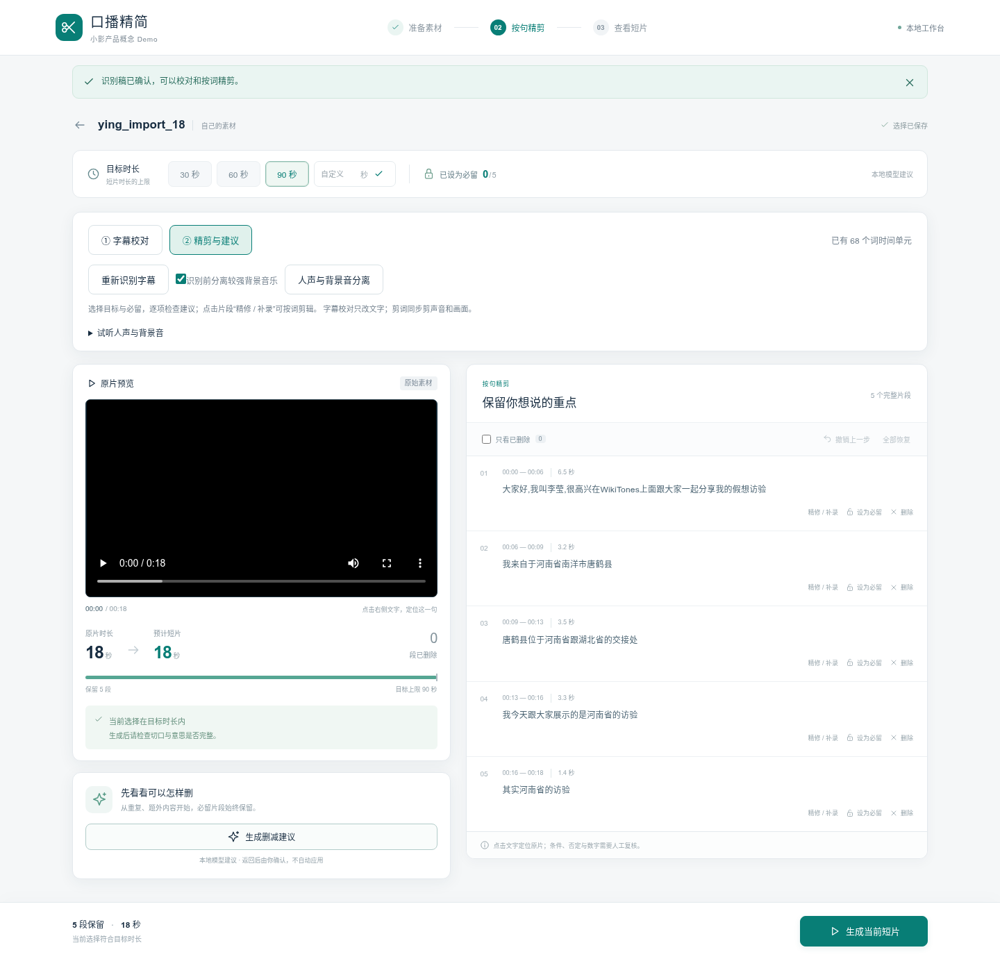

实际测试包含两条真人视频、20秒纯器乐输入，以及24秒真人口播加程序生成配乐的受控版本。纯器乐没有生成伪口播。带BGM测试记录分离前后字幕和耗时；原声识别稿是比较基线，不是人工真值，不能据此宣称识别准确率提高。本次受控测试还出现分离后把“云南”识别为“越南”的情况，说明分离可能引入新的识别错误，因此保留原声试听和作者确认。

确定性媒体测试使用颜色帧与已知频率验证：剪词同时缩短画面和声音；重排实际改变帧顺序与声音顺序；字幕跟随同一清单。独立浏览器验收真正上传、调用模型、播放并下载；单元测试中的推理桩不计入实际推理证据。

最终验证：57项后端测试、9项前端测试、21组原流程及12组V2浏览器检查通过；HTTP、实际重启及旧项目兼容通过。新版连续录屏171.04秒，包含真实声音、模型处理等待和下载。证据见acceptance/browser_validation.json、speech_validation.json、bgm_validation.json及FINAL_VALIDATION.json。处理失败、并发编辑、刷新、重启、旧版本下载和同目录重复启动均需保持已确认编辑安全。

## 6. 不足、取舍与后续路线

当前最显著的不足是方言与专名识别误差、逐词对齐的帧级分辨率、补录后的口型不一致、模型建议的语义判断仍需要作者确认，以及CPU处理时延。人声分离也不能保证排除背景歌曲中的人声或多人重叠。

本轮优先完成可核对的真实任务链。下一阶段按影响排序推进：基于作者校正稿的强制对齐；对词切口提供更方便的微调与前后试听；收集真人补录和多类BGM材料；在有明确声源授权与资源条件后单独验证同声线合成；最后对接宿主工程和发布流程。

用户研究应邀请中文教程、知识分享与经验分享作者，用自己的素材分别完成现有流程和V2流程。记录总耗时、有效导出、错误修正、建议采纳、恢复操作和是否愿意再次使用。没有这些数据前，市场价值保持为可验证假设。

## 7. 交付与复现

工程继续使用Python/FastAPI、原生ES modules和FFmpeg。语音依赖与模型单独准备；运行说明见README_V2.md，接口扩展见API_CONTRACT.md。模型和大媒体不放入Git，源码与轻量证据同步至用户指定仓库。

交付包括旧版基线、V2实际截图、连续操作录屏、真人样例来源记录、完整报告、五页摘要、真实MP4/SRT/记录、交接包及源码包。最终招聘平台提交由用户完成。

参考来源：

- VivaVideo：https://quvideo.com/zh-Hant/products
- CapCut：https://www.capcut.com/resource/edit-video-with-text
- Descript：https://help.descript.com/getting-started/edit-like-a-doc
- Premiere：https://helpx.adobe.com/premiere/desktop/edit-projects/edit-video-using-text-based-editing/overview-of-text-based-editing.html
- faster-whisper：https://github.com/SYSTRAN/faster-whisper
- Demucs：https://github.com/facebookresearch/demucs
- Qwen模型：https://huggingface.co/Qwen/Qwen2.5-7B-Instruct-GGUF
- 真人素材出处与许可：fixtures/real_tao_v2/manifest.json、fixtures/real_ying_v2/manifest.json
